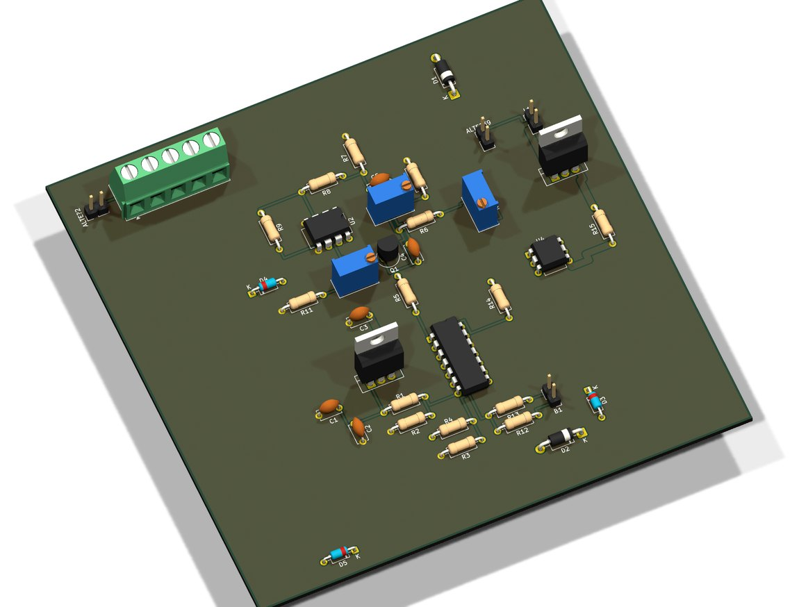

# Power Electronics Design & Simulation Suite
> AC power controllers, a 0–10 V industrial dimmer, a digital tachometer and a brushless drive, designed and simulated end to end.
`2025` · `Proteus` · `Power electronics` · `Analog design` · `Microcontroller` · `PSIM`



## About

A body of power-electronics design work carried through schematic capture and full mixed-signal simulation before any board was built.

It covers phase-angle AC power controllers (including a capacitive-trigger variant), a 0–10 V industrial power regulator matching the standard control-signal interface used on drives and dimmable ballasts, a microcontroller-based digital tachometer, and a brushless motor drive — alongside characterisation work on transistor stages and power amplifiers.

Simulating first is the point: switching topologies punish the difference between a circuit that works on paper and one that survives a real inductive load.

## Contents

```
captures/
docs/
kicad/
```

## Notes

## Documents

- [`docs/gradateur-0-10V-projet-tutore.pptx`](docs/gradateur-0-10V-projet-tutore.pptx): the tutored-project defence for the **0-10 V power dimmer** (ENIG, 2024/2025), by Mahmoudi Lassaad, Omri Salim and Dhaoui Chahin. It covers the 7812 supply, the LM358 stage, the PWM power control, the simulation and the PCB. The related boards are `kicad/VARIATEUR_0_10V/` and `kicad/GRADATEUR_DE_PUISSANCE/`.

## Third-party work used here

Everything in this repository is my own work. It builds on the following, which are **not** mine and are used under their own licences:

- **KiCad** by KiCad project — <https://kicad.org>
- **Proteus Design Suite** by Labcenter Electronics — <https://labcenter.com>

## Author

Lassaad Mahmoudi — <assaadmahmoudi0@gmail.com>  
https://linkedin.com/in/mahmoudi-assaad
